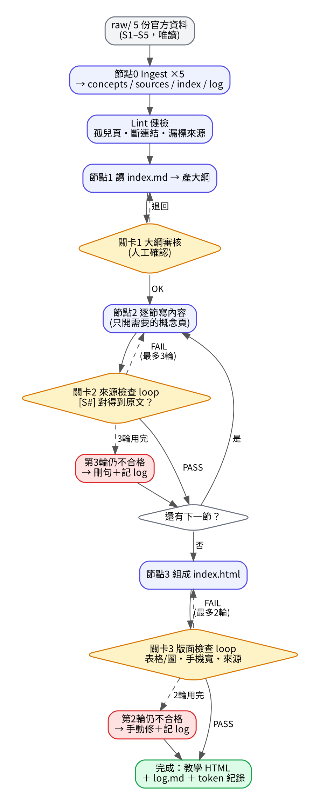

# 4. Loop / Graph 流程說明

## 為什麼用「Graph 套 Loop」
- **Graph**：把「從 Wiki 做出教學頁」拆成 4 個節點、3 個關卡，哪一步出錯一眼就看得到。
- **Loop**：在最容易出錯的地方（來源、版面）反覆檢查，直到合格。
- **跟主題的關聯**：逐節寫、每次只打開需要的概念頁，context 裡只放必要的東西，這本身就是一種省 token 的設計。

## 節點與關卡
| 步驟 | 做什麼 | 檢查什麼 | 停止條件 |
|---|---|---|---|
| 節點0 Ingest ×5 | 每份資料 → 摘要頁＋概念頁，更新 index/log | 之後跑一次 Lint | Lint 修完 |
| 節點1 產大綱 | 只讀 index.md 規劃 ≤6 節 | **關卡1（人工）**：①②③⑤ 都有、每節對得到概念頁、≤6 節 | 人工按 OK |
| 節點2 逐節寫 | 一次一節，只開需要的頁 | **關卡2（loop）**：每個 [S#] 能貼出原文、沒漏標、沒（待查） | PASS 或 **最多 3 輪**；第 3 輪仍不合格就刪句並記 log |
| 節點3 組 HTML | 組成單一 index.html | **關卡3（loop）**：每節有表或圖、手機寬不爆版、來源可點 | PASS 或 **最多 2 輪**；之後手動修 |

## 為什麼每個 loop 都要設上限
沒有上限的 loop 可能一直改、一直檢查，**token 越燒越多卻不會變好**。設上限、到了就換處理方式（刪句、手動修），才是可控的流程。

## 實際跑完後的修改（v2）
`flow.png` 是一開始的設計。跑完一次後，關卡 2 改成「自動＋人工」兩段，`flow.dot` 已經同步更新（這台電腦沒有 Graphviz，`flow.png` 還沒重新產生）。

| 改了什麼 | 為什麼 |
|---|---|
| 關卡 2 改用 `scripts/check_sources.py` 自動比對：每個 [S#] 都要在 `output/evidence-N.md` 有一列「原文」，而且原文真的出現在 `raw/` 對應的檔案 | 「貼原文」交給程式比對，不靠 AI 自己說「有對到」 |
| 寫一節時，同時寫那一節的證據表（先有原文才寫句子） | 6 節第 1 輪全部 FAIL，其中 4 節是「自己加的總結句或推論沒有來源」，在寫的當下就先找原文，可以少一輪 |
| 自動比對 PASS 之後，加一步「人工語意複讀」 | 程式只能確認「這段原文存在」，不能確認「句子的意思等於原文」。第 5、6 節共 3 處是摘錄對得上、意思卻多講了，都是人工才抓到 |
| 檢查器的格式正規化（拿掉 markdown 的 * 和 `）在第 3 節後修正 | 前 4 節有 3 次 FAIL 是格式問題不是內容問題，這種假警報會浪費一輪 |
| log 時間一律用系統時間自動填（`date`） | 一開始 agent 預填了不存在的時間，log 只能往後加，只好追加更正 |
| 關卡 3 多一步「HTML ↔ section 一致性檢查」 | 確保組 HTML 時沒有偷偷改到已經檢查過的句子 |
